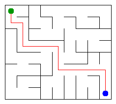

# Assignment 3. Maze Escape

Student ID: 250629
Name: Islam Brimbayev
Group: SE-2536
Maze size (rows x columns): 9 x 9

This file is the report. Fill it in as you go. How to start: `START_HERE.md`. The task: `docs/Assignment3.pdf`.

## Program output

The 13 lines your program prints on your data (`java -cp out Main`):

    Broken: 71
    Kept: 56
    Last broken wall: 112
    MST cost: 25569
    Heaviest broken wall: 702
    Path length: 15
    DFS visited: 46
    Dead ends: 23
    Zones: 8
    Largest zone: 14
    Is DAG: 0
    Flow stages: 5
    Fastest route cost: 7

My maze:

## Questions

Answer in your own words, two or three sentences each.

Mission 0. What do find and union do, and what makes them fast in your code?
`find` determines the root element of the set containing a specific cell, while `union` merges two disjoint sets together. They are exceptionally fast in this implementation due to path compression during `find` and size-based merging during `union`, resulting in near-constant amortized time.

Mission 1. Why is Broken always R*C - 1, and Kept always (R-1)*(C-1)?
A maze generated as a spanning tree over $R \cdot C$ cells requires exactly $R \cdot C - 1$ edges (broken walls) to keep all cells connected without any cycles. Since the total number of internal walls in a grid is $2RC - R - C$, the remaining unbroken walls equal $(R-1)(C-1)$.

Mission 2. My MST cost from Kruskal and from Prim, and why they are equal:
The Minimum Spanning Tree cost for both Kruskal and Prim is 25569. They are identical because both algorithms are optimal approaches designed to find the minimum possible total edge weight required to connect all vertices in the graph.

Mission 3. Why is there exactly one path between two cells? How did you avoid a stack overflow on a huge maze?
Because the maze structure is an acyclic spanning tree, there is precisely one simple path between any two cells. To prevent stack overflow on large mazes, an explicit stack (`Deque`) was utilized for the iterative traversal instead of recursive method calls.

Mission 4. Why does the second pass of Kosaraju go on the reversed graph? Why do the slides have no cycle exactly when Zones equals the number of cells?
The second pass uses the reversed graph to correctly isolate strongly connected components in the order of decreasing finish times from the first pass. When the number of zones matches the total number of cells, every zone consists of a single vertex, meaning no cycles exist and the graph forms a Directed Acyclic Graph (DAG).

Mission 5. Why is it enough to go through the zones in the order of their numbers? What does this pass cost?
Since the zone numbering follows a topological sort order generated by Kosaraju's algorithm, all inter-zone edges proceed strictly from smaller zone numbers to larger ones. This allows linear dynamic programming evaluation in $O(n + m)$ time without needing a priority queue.

## AI use

Gemini for understanding

## Timing (Mission 7)

Milliseconds, 5 runs each, from `java -cp out Bench`.

| maze | Kruskal | Prim |
|---|---|---|
| 100 x 100 | 23 | 15 |
| 300 x 300 | 125 | 129 |
| 1000 x 1000 | 2115 | 3184 |

What do the numbers say about how the time grows? Two or three sentences.
The execution time grows polynomially as the size of the maze increases. Kruskal's algorithm scales more efficiently on larger sparse graphs due to sorting edges and DSU operations, whereas Prim's priority queue overhead becomes more pronounced at 1000 x 1000.

## Complexity

n is the number of cells, m the number of walls (or slides). Fill in every algorithm you wrote.

| algorithm | time | space | assumptions |
|---|---|---|---|
| DSU find and union | $O(\alpha(n))$ | $O(n)$ | Path compression and size weighting |
| Kruskal | $O(m \log m)$ | $O(m + n)$ | Edge sorting via array wrapper |
| Prim | $O(m \log n)$ | $O(m + n)$ | Binary heap priority queue |
| DFS | $O(n + m)$ | $O(n)$ | Explicit stack traversal |
| Kosaraju | $O(n + m)$ | $O(n + m)$ | Two-pass DFS on directed graphs |
| Route in the zone graph | $O(n + m)$ | $O(n + m)$ | Topological order traversal |

## Before you submit

- data/walls.txt, data/slides.txt and output/maze.png are in the repository.
- `java tools/Check.java` shows all examples right.
- This README is filled in, the program output and the section AI use included.
- The work is pushed to main (at least one commit per mission) and the repository is public.
- The link is attached in Moodle.